# AOS — Autonomous Orbital Sentinel

An interactive orbital operations console that runs entirely in the browser. It brings together live satellite data, real-time space weather, and a trained model for forecasting solar storms. You can interact with an AI operator, control the camera using hand gestures, and use a Rust scripting layer to load your own physics models. The interface even features a custom typeface designed specifically for its readouts. No build step or installation required beyond Node.js.

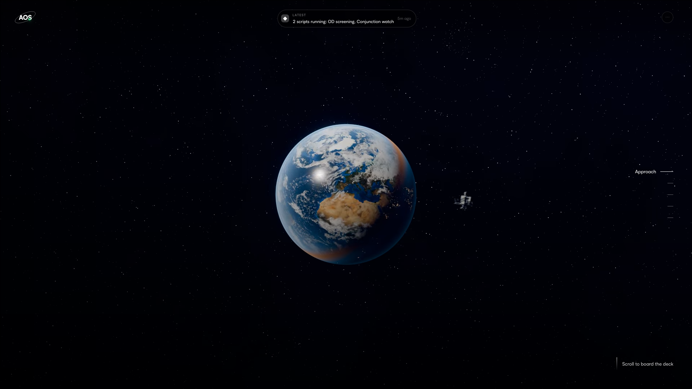

AOS has two main parts. The first is **the deck**: a pre-rendered journey around Earth and a space station. Users can scroll through its four sections — approach, deck, fleet, and ground — then select *Open the console* to enter the live scene. The rest of this guide focuses on the console and the pages built around it.

> **A note about devices:** AOS is designed for laptops. Phones and tablets are redirected to a dedicated restricted-access page.

## Quick start

```sh
npm run dev     # http://localhost:5173
npm test        # headless checks on the simulation layer
npm run core    # rebuild the Rust engine, only if you changed it
```

You only need Node 18 or later. three.js is loaded from esm.sh, the Rust engine is included as a committed `.wasm` file, and the forecaster is already trained. You need `cargo` for only two things: making changes to the engine and letting the server compile operator scripts.

AOS works even with an empty `.env` file. If you want to enable any of the optional services, copy `.env.example` to `.env` and add the credentials you need: an LLM key for Sybil, Google credentials for sign-in, or SMTP settings for verification emails.

## The console

Open `/console` (or get there by clicking through from the deck).

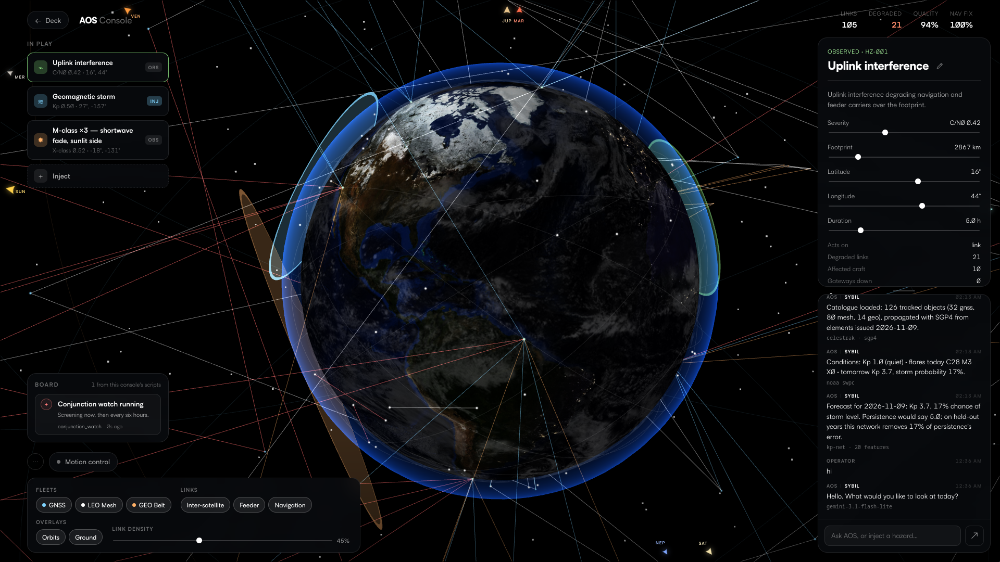

**Moving around.** Drag to rotate the Earth and scroll to zoom in or out. The globe follows the Sun's actual direction to show which areas are in daylight and which are in darkness. You'll also see clouds, a thin atmospheric glow, and a starfield in the background.

**The fleet.** AOS starts with 102 spacecraft spread across three constellations: GNSS at 20,200 km, a LEO mesh at 550 km, and a GEO belt at 35,786 km. If CelesTrak is reachable, though, the console uses its real catalogue instead, propagating live TLEs with SGP4. That means GPS satellites appear where they actually are, rather than at approximate positions. Starlink is sampled from its catalogue of more than ten thousand objects to keep the display readable.

**The layer panel**, at the bottom of the screen, lets you show or hide constellations, orbit rings, links, and labels. Use the density slider to reduce the number of links on screen; displaying everything at once gets cluttered quickly.

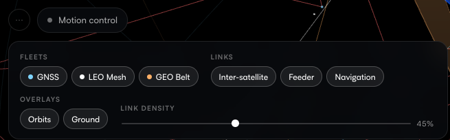

**Links** are recalculated every frame. The console draws connections between satellites, feeder links down to ground gateways, and navigation links from GNSS. Each connection is checked for line of sight, so none of them will appear to pass through the Earth.

**Select anything.** Clicking a satellite opens its orbit, links, and subsystem details in the inspector on the right. Selecting a hazard brings up its details there instead.

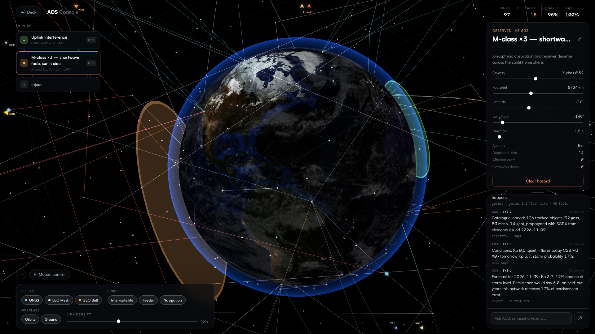

### Hazards

Out of the box AOS includes five types of hazards: solar flares, geomagnetic storms, debris conjunctions, ground outages, and RF interference. Each one has a location, footprint, severity, and duration. They also affect different parts of the simulation, including links, orbits, spacecraft, and ground infrastructure.

The stack in the top-left corner shows which hazards are currently active. The flag beside each one tells you where it came from:

| Flag | Meaning |
| --- | --- |
| `OBS` | NOAA is observing it right now |
| `FCT` | The forecaster predicts it for tomorrow and provides a confidence level |
| `INJ` | You added it yourself to see how it affects the simulation |
| `SCR` | One of your scripts created it; the script's name is shown |

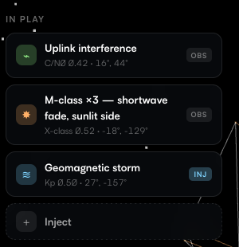

You can add your own hazards through the picker. Choose a type, place it on the globe, and adjust its settings afterwards. Each new hazard starts with default values, so you don't need to get every setting right before adding it. Any custom hazard types you've created in Core also appear in this picker.

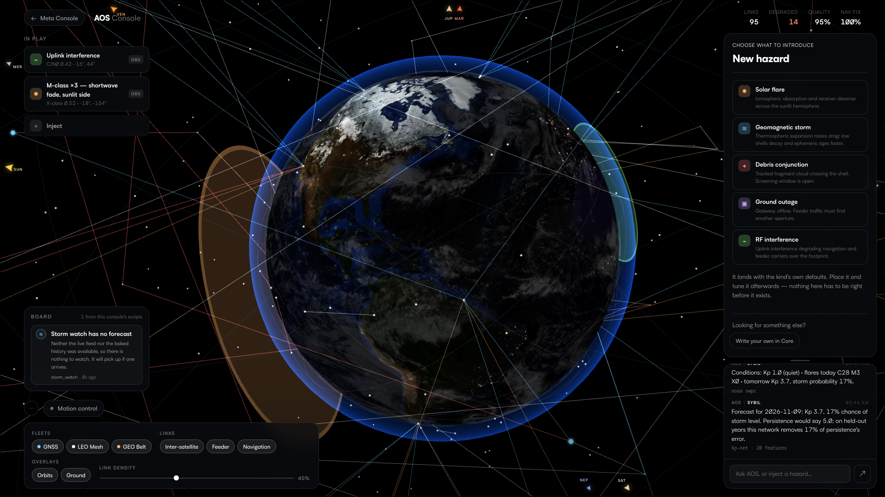

### Edge bearings

Small arrows along the edge of the window point towards the Sun and the seven planets. Since those bodies aren't drawn directly in the scene, the arrows give you a sense of where they are. Their position along the edge shows their direction, while their size and brightness indicate whether they're in front of you or behind you.

These directions aren't approximations: they're calculated using a real ephemeris (`src/orbital/ephemeris.js`) and checked against known astronomical events and measurements, including equinox dates, perihelion, and planetary elongations. That makes them reliable enough to use for navigation.

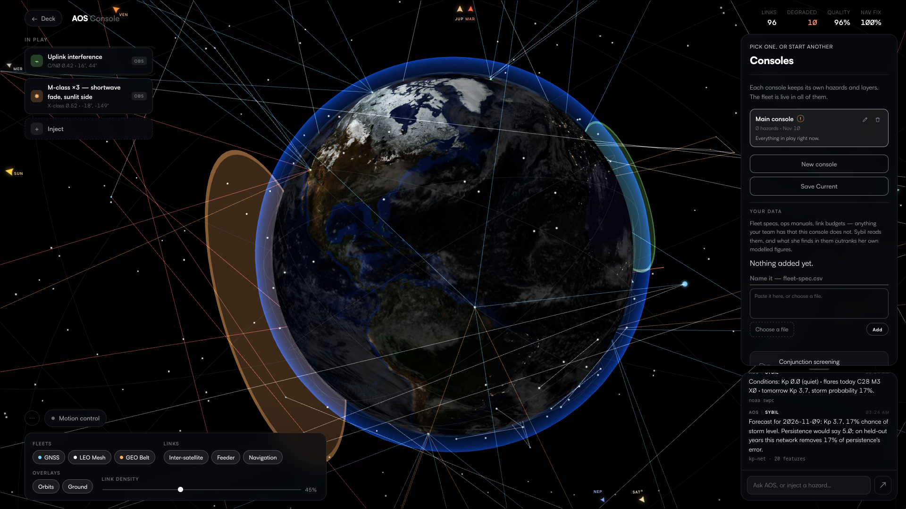

### Conjunction screening

Run a screening and the engine checks the fleet for satellites that are approaching one another too closely. You can click any result to inspect the spacecraft involved. If you prefer, you can replace the screening algorithm entirely with one of your own scripts (see Core below), or have a script start screening runs automatically.

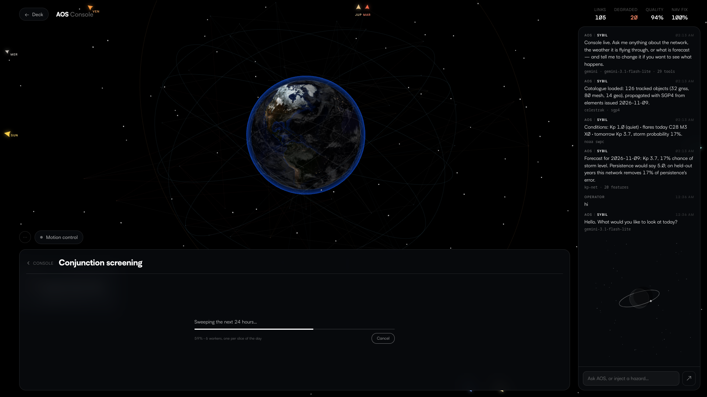


## Sybil

The chat window in the corner belongs to Sybil, AOS's operator agent. She can carry out the same actions you can from the console: add or clear hazards, focus on satellites, toggle layers, check forecasts, run screenings, and write and build Rust scripts. She can also combine tools to answer more involved questions. For example, finding the Sun's position relative to the satellite worst affected by a hazard takes two tool calls and one response.

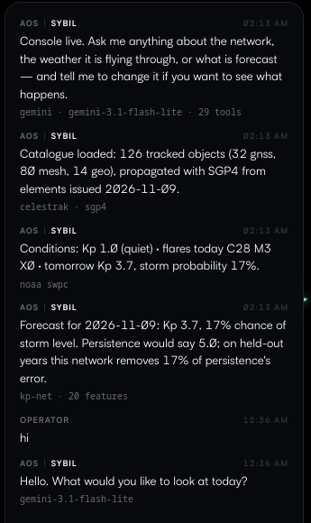

One rule matters above all: **Sybil never invents numbers.** Every figure in her responses comes from a tool that has read the simulation, a live NOAA feed, the forecaster, or one of your scripts. Ask how accurate a forecast is, for instance, and she'll retrieve the model's actual scorecard, including its limitations.

Things to try:

```text
status
inject a severe solar flare over the Indian Ocean
what's worst affected?
put a storm on the side facing Venus
raise hz-003 to 0.9
has it been stormy lately?
write me a script that warns when Kp crosses 5
```

Sybil is designed to stay focused on AOS: the console, its network, orbital mechanics, and space weather. If you ask about something unrelated, she'll decline briefly.

### Connecting a model

Add one API key and start the server. If more than one provider is configured, the first available one is used:

```text
ANTHROPIC_API_KEY   OPENAI_API_KEY   GROQ_API_KEY   GEMINI_API_KEY   OPENROUTER_API_KEY
```

```sh
ANTHROPIC_API_KEY=sk-... npm run dev
AOS_PROVIDER=groq AOS_MODEL=llama-3.3-70b-versatile npm run dev
```

You can also put your key in `.env`. Run `npm run models` to see which models your key can actually access. That's more reliable than guessing model IDs that may have been retired.

Gemini's free tier uses `gemini-3.1-flash-lite` by default. The larger models share a relatively small daily quota, and an agent that chains tools can use several requests for a single question. If you have enough quota available and want the stronger reasoning model, set `AOS_MODEL=gemini-3.6-flash`.

**Don't have an API key? The chat still works.** Sybil switches to a local keyword parser that understands common commands, such as checking the status, adding hazards, and looking things up by ID. It also makes it clear that this is the fallback mode.

**Your API key never reaches the browser.** The page sends requests to `/api/chat` on the same origin, and the server forwards them to the provider. The tools themselves run in the browser because they control what appears in the console. Simulation data isn't sent through the relay.

The relay also handles some of the problems that come with free-tier API limits. It backs off with jitter when a provider returns a 429, trims oversized tool results, and keeps conversation history to 24 turns without separating a tool result from the call that produced it. It also makes one final round without tools, so a model that keeps asking to use another tool eventually has to give you an answer. Gemini's thought signatures are preserved where needed and stripped for Anthropic, allowing a recorded conversation to be replayed with either provider.

### The toolbox

Here's a breakdown of the tools Sybil can use, grouped by what they do:

| | |
| --- | --- |
| **Network** | `network_summary` `list_satellites` `find_satellite` `worst_affected` `list_ground_stations` |
| **Sky** | `sun_from` `sky_bearings` |
| **Hazards** | `list_hazard_kinds` `list_hazards` `inject_hazard` `update_hazard` `clear_hazard` |
| **Weather** | `space_weather_now` `storm_forecast` `forecast_model_card` `recent_activity` |
| **View** | `focus_satellite` `adjust_view` `set_layers` |
| **Scripts, running** | `list_scripts` `ask_script` |
| **Scripts, as code** | `list_script_files` `read_script` `write_script` `enable_script` `reorder_scripts` `delete_script` `build_scripts` |
| **The contract** | `list_scripting_reference` `read_scripting_reference` |
| **Consoles** | `list_consoles` `open_console` `save_console` `create_console` `rename_console` `delete_console` |
| **Screening** | `run_screening` `screening_result` |

A few details are worth keeping in mind:

- Hazard footprints are specified in kilometres. `HAZARD_LIMITS` applies limits to every value, no matter where it comes from.
- You can ask Sybil to put a flare on the side of Earth facing Venus. She uses `sky_bearings` to find the relevant point on Earth and places the hazard there.
- If you add the same type of hazard more than once, each one gets a number — for example, "Solar flare" and "Solar flare (#2)" — so you can refer to them individually.
- When you place a hazard, the globe smoothly turns to face it. The zoom level stays the same.
- Deleting a script or console takes two turns. On the first attempt, Sybil stops and tells you exactly what would be deleted.
- If Sybil writes a script but it hasn't been built yet, she knows that and won't claim that its behaviour is already running.

## Live data and the forecast

Three parts of the console use actual measurements rather than simulated values. All three come from public data feeds, and none requires an API key:

- **The fleet** — CelesTrak TLE data, with satellite positions calculated using SGP4. CelesTrak refreshes the data several times a day.
- **Space weather** — NOAA SWPC's daily measurements, including Kp, F10.7, sunspot numbers, and flare counts. When Kp rises above 4, the console adds an `OBS` storm in the auroral oval. A day with a flare also creates an `OBS` hazard at the subsolar point.
- **Historical record** — GFZ Potsdam's geomagnetic data, going back to 1932. This is the dataset used to train the forecaster.

Each feed has a timeout and a fallback, and the console tells you which source is currently being used. If CelesTrak is unavailable, the modelled constellation stays on screen. If NOAA can't be reached, the forecast falls back to the historical data already included with AOS.

**The forecaster** is a small neural network trained on 78 years of geomagnetic data. Each day, it predicts the following day's maximum Kp and the probability of a geomagnetic storm (Kp ≥ 5). Its prediction appears in the hazard stack as an `FCT` entry, along with the model's confidence.

Tests on held-out years from 2015 onwards show that it performs better than climatology, persistence, and ridge regression across RMSE, MAE, and Brier score. Its RMSE at a one-day lead is around 1.1 Kp, which puts it in the range of operational forecasts. You can ask Sybil for the model card to see the full results, including the limitations. Forecasting storms a day ahead is difficult because the measurements that reveal whether one will actually happen are only available about an hour beforehand.

You can retrain the model yourself:

```sh
npm run data    # download the geomagnetic record and refresh the included data
npm run train   # train the network, print its scorecard, and save the weights
```

## Motion control

You can also control the console using hand gestures. Turn motion control on using the toggle at the bottom-centre of the screen, next to the layer panel. The camera won't respond until you click to activate it.

| Posture | Effect |
| --- | --- |
| Open palm | Zoom in |
| Closed fist | Zoom out |
| Index finger out | Turn in the direction the finger points |
| Thumb out | Turn in the direction the thumb points |
| Index and thumb out | Turn in the direction halfway between the two fingers |

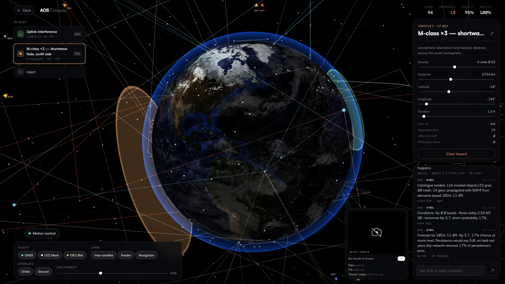

Each gesture works like holding down a key: the view keeps responding for as long as you hold the posture, then slows down when you release it. Think of your hand as a dial. Point in a direction and the camera moves that way. If you want to point somewhere else, rotate your whole hand. Folding a finger across an upright palm counts as a fist, as you'd expect.

Behind the scenes, AOS uses MediaPipe hand tracking and a geometric classifier that measures hand posture in 3D relative to the size of your hand. That means it works whether you're sitting close to or farther away from the camera. The gesture types are designed not to overlap, and a debounce step prevents a noisy frame from interrupting a gesture you're holding.

The tracking pipeline has 89 tests using synthetic hand movements. The only parts those tests can't cover are the pieces that interact directly with the webcam. The preview panel is useful for troubleshooting: it shows the hand skeleton, live posture scores, and how far each finger is extended, making it easier to see why a gesture might not be recognised.

Your camera feed stays on your device. Frames go from the camera to the model running in the browser tab, then to the preview, and are discarded. Nothing is recorded or sent elsewhere. The camera is released as soon as you turn off the panel or leave the page. The first time you use motion control, the browser downloads the model (around 8 MB) from a CDN and caches it for later. Because `getUserMedia` requires a secure context, start AOS with `npm run dev` and use localhost rather than opening the files with `file://`.

## Core — write your own physics

Core is the middle section of the deck, and it's where AOS becomes more than a demonstration. You can write Rust code against a published interface, upload it, and have the server compile it. Your code then runs inside the simulation under the same rules as the engine's built-in code. That means your hazards behave like regular hazards, your spacecraft become part of the fleet, and your own conjunction-screening algorithm can replace the default one.

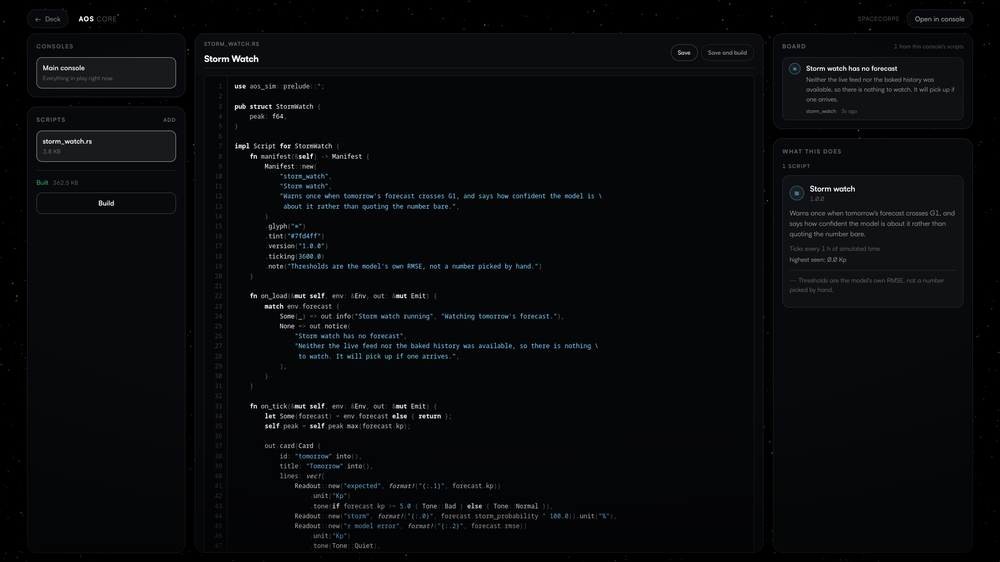

Core is organised into four areas. The **board** at the top shows what your scripts have reported. The **shelf** holds your consoles and the files associated with each one. The **viewer** displays a selected file alongside compiler output. Finally, the **brief** shows what the compiled bundle actually registered. That information is read directly from the WASM file, rather than copied from a description, so it can't quietly become outdated.

Here's how the workflow goes:

1. Download the scripting contract so your editor can recognise the available types:
   `curl -O http://localhost:5173/api/scripting/aos-sim.tar.gz`
2. Create a Rust crate against that contract using your own editor and tools.
3. Upload the `.rs` file to the shelf. If your script has dependencies, include its `Cargo.toml` too.
4. Build it. Any errors appear in the viewer, with markers beside the lines mentioned in the compiler output. You can fix the code and rebuild without leaving the page.
5. Open the console. Your board entries, hazards, and hazard types will appear there, marked `SCR` and labelled with your script's name.

Scripts can do quite a lot:

- **Create new hazard types** — define their footprint, envelope, and an effect method for each thing they influence. Footprints can be combined, so you can describe something as specific as "the auroral oval, above 400 km, but not over my stations."
- **Add spacecraft** — create your own fleet, including Walker patterns, sun-synchronous orbits, real orbital elements, and custom tags.
- **Replace algorithms** — you can provide your own propagator, conjunction-screening algorithm, link budget, atmosphere model, or visibility calculation. The page also shows the consequences of getting each override wrong.
- **Respond to events** — scripts can react to simulation ticks, weather updates, screenings, conjunctions, and selections. They can also send notifications, move the camera, request screening runs, and respond to Sybil.

You can use any crate published on crates.io as a dependency. Builds run inside a bubblewrap sandbox with two separate stages. During vendoring, network access is allowed but nothing is executed. During compilation, code can run, but it has no network or home-directory access, the database is unavailable, the system is read-only, and CPU and file-size limits apply.

`npm run test:forge` tests the sandbox itself against a live environment. A basic script that only uses the contract takes about six seconds to build; adding `nalgebra` brings that to around thirteen seconds. If bubblewrap isn't available on the host, AOS refuses to compile scripts with dependencies rather than building them without isolation. The page also tells you which mode it's using.

Scripts are linked directly into the engine's WASM bundle. As a result, something like a hazard's `affect_link` method can be included directly in the link-processing loop, rather than crossing the JavaScript boundary hundreds of thousands of times during a sweep.

The engine also keeps runaway scripts in check. If a script uses more than 6 ms per frame for two seconds, or exceeds its hook budget twice, it gets stopped and a notification identifies it. Every value reported by a script also keeps track of where it came from (`Observed`, `Forecast`, `Injected`, `Scripted`, or `Modelled`). That's important: the console is built around the idea that a modelled value should never be presented as though it were a real measurement.

**`docs/SCRIPTING.md` documents the full interface.** The `examples/` directory contains seven working scripts that compile successfully and cover nearly all of the available features. `storm_watch.rs` is a good place to start. Sybil can write scripts too, using the same endpoints and following the same rules. She reads the contract first because `aos-sim` isn't part of any model's training data.

## Accounts

The profile page is the left-hand section of the deck. You don't need an account to use AOS; the console works without signing in. If you do sign in, though, your injected hazards, Sybil conversation history etc. are saved to your account (indicated by the status light in the wordmark turning green). Our authentication system is however equipped with JWT-based secure session management, Google OAuth Verification, CSRF Prot. and so much more, hence it is highly advisable that you take a moment to set up an organizational acc. (Note: Sign in via Google may be temporarily disabled while the establishment undergoes Google's Application Verification Process - Standard Procedure)

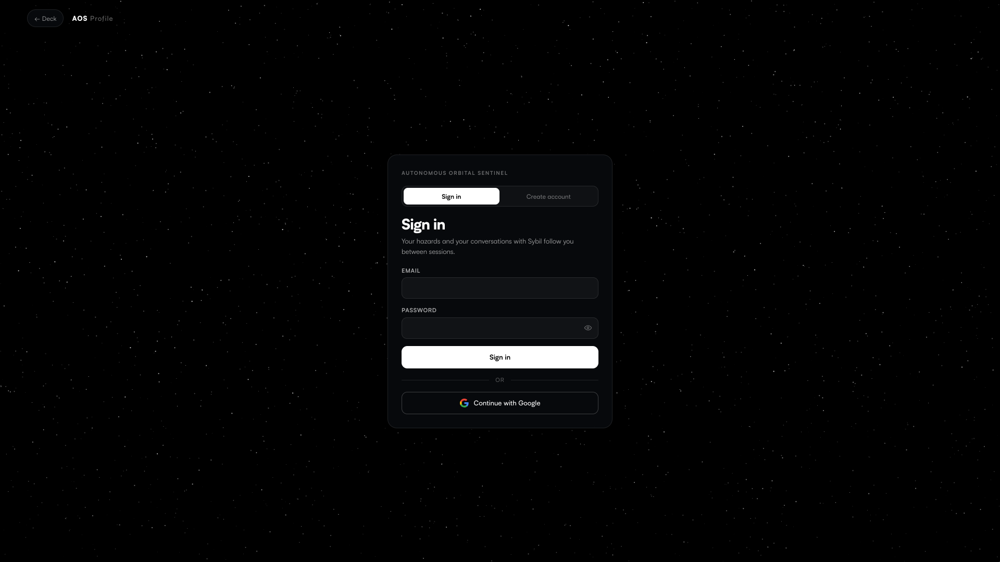

- Create an account with a password and verify it by email, or use **Google sign-in**. Google sign-in uses an authorization-code flow with a `state` cookie. If the Google account uses an email address that already belongs to a password-based account, the two accounts are linked rather than creating a duplicate.
- Passwords are stored using scrypt (`N=2^16`, `r=8`) with a separate salt for each account, and comparisons run in constant time. Sessions use 32 random bytes in an `httpOnly` SameSite cookie. Only a SHA-256 hash is stored, and sessions last for thirty days.
- Sign-in attempts are rate-limited to eight per address every fifteen minutes. From the outside, an incorrect password and an unknown email address look the same. Changing your password also ends every other active session.
- The account stores your email, name, organisation, optional phone number, notes, your latest 60 Sybil questions, and up to 120 injected hazards. It doesn't collect anything else — there's no telemetry.
- All account data lives in a single SQLite file using `node:sqlite`. The schema is created the first time the server starts, and there are no runtime dependencies or extra services to run.
- If SMTP isn't configured, verification links are printed in the terminal and saved under `data/mail/`. That means a fresh checkout can still handle account verification without any mail-server setup.

## Known gaps

- If CelesTrak can't be reached, AOS falls back to a synthetic Walker constellation. The log makes it clear when this happens.
- Hazard effects currently use Spatial Geometric Heuristics forgoing Scintillation Models, and debris objects aren't propagated.

## Map of the repo

```text
index.html              deck, scroll scaffold
orbital.html            live console
core.html               core, where an operator's scripts live
profile.html            the gate and the profile sheet
device.html             the wrong-device page
404.html                the lost page

src/main.js             deck wiring
src/director.js         hold-to-hold state machine
src/stage.js            still and clip playback
src/media.js            preloading, codec choice
src/data/scene.js       holds and hotspots
src/device-gate.js      turns incompatible devices away

src/orbital/world.js    orbits, links, hazards, summary
src/orbital/globe.js    three.js scene, picking
src/orbital/ui.js       layers, hazard stack, inspector, chat
src/orbital/data.js     constellation definitions, scale
src/orbital/catalogue.js   CelesTrak elements and SGP4 propagation
src/orbital/spaceweather.js live NOAA feeds, spliced onto the baked tail
src/orbital/kpfeatures.js  the feature set, shared by trainer and console
src/orbital/forecast.js    inference on the trained weights
src/orbital/live.js        measurements and predictions into hazards
src/orbital/model/         the trained network and its scorecard
src/orbital/ephemeris.js   Sun and planet positions, from Keplerian elements
src/orbital/bearings.js    edge-of-screen direction arrows
src/orbital/tools.js       the agent tools, with schemas
src/orbital/sybil.js       the agent loop and system prompt
src/orbital/agent.js       the keyword parser, used when no model is set
src/orbital/core.js        the bridge to the engine
src/orbital/instance.js    the open console's own scripts, running
src/orbital/filters.js     One Euro smoothing and helpers
src/orbital/tracking.js    hand features and identity across frames
src/orbital/gestures.js    posture classification and rates
src/orbital/hands.js       webcam and the gesture-recognition model

src/core/main.js        page wiring, the build, and the bundle preview
src/core/ui.js          the board, the shelf, the viewer, the brief
src/core/client.js      the script endpoints, from the page
src/profile/            the gate, the sheet, and the sky behind them
src/session.js          who is signed in, shared by all pages
src/ui/board.js         the notification board, shared by both pages

core/aos-sim/           the scripting contract: types and traits only
core/aos-core/          the engine: propagation, screening, links, hazards, host, ABI
core/aos-instance/      the wasm bundle, engine plus this instance's scripts
assets/core/            the committed default bundle
docs/SCRIPTING.md       the whole contract surface, documented
examples/               seven working scripts

scripts/serve.mjs       the dev server
scripts/llm.mjs         provider adapters for the chat relay
scripts/core.mjs        builds the engine and installs it
scripts/forge.mjs       compiles an operator's scripts, in a sandbox
scripts/spaceweather.mjs downloads 94 years of geomagnetic record
scripts/train-kp.mjs    trains the forecaster, prints the scorecard
scripts/db.mjs          SQLite schema and statements
scripts/accounts.mjs    validation, scrypt, sessions, throttling
scripts/api.mjs         the account endpoints
scripts/mail.mjs        SMTP client and the no-mail fallback
scripts/oauth.mjs       Google's authorization code flow

test/                   1100+ checks: simulation, engine ABI, forge jail,
                        accounts, auth end to end, ephemeris, tracking,
                        gestures, forecaster, TLE parsing, LLM adapters
media/                  pre-rendered holds, clips, loop
assets/textures/        NASA Blue Marble day, night, clouds
```

## Custom Typeface

Every number on the site uses **AOS Console**, a typeface designed specifically for this project. It isn't a font you can simply download: `scripts/buildfont.py` creates it - inspired by Satoshi, and that process is what makes it work for the console. The readouts need **tabular figures**, so changing a digit doesn't shift the rest of the column, and a **slashed zero**, so a zero can't be mistaken for the letter O in a satellite ID. Satoshi supports the first through an optional OpenType feature, but doesn't include the second.

Optional font features are awkward here because browsers only use them when explicitly asked to, and they don't apply inside `<canvas>` — which is where the console draws its graphics. To avoid that problem, the build puts the alternate forms directly into the font's cmap, making them the default glyphs. Canvas can then use them without any extra configuration.

The slashed zero is made by placing Satoshi's own `slashlongcomb.case` glyph over its tabular zero, since the font doesn't provide a feature for that combination. The build also includes a single-storey **a** and **g**, along with alternate versions of **G**, **t**, and **Q**.

To rebuild the font:

```sh
python -m venv .venv && .venv/bin/pip install fonttools brotli
.venv/bin/python scripts/buildfont.py
```

The original Satoshi files may be found in `assets/fonts/` as the build source and CSS fallback.

## Credits

The Earth textures come from NASA Visible Earth: Blue Marble Next Generation, Black Marble 2016, and a cloud composite (public domain). The Satoshi typeface is by Indian Type Foundry and is available through Fontshare.
